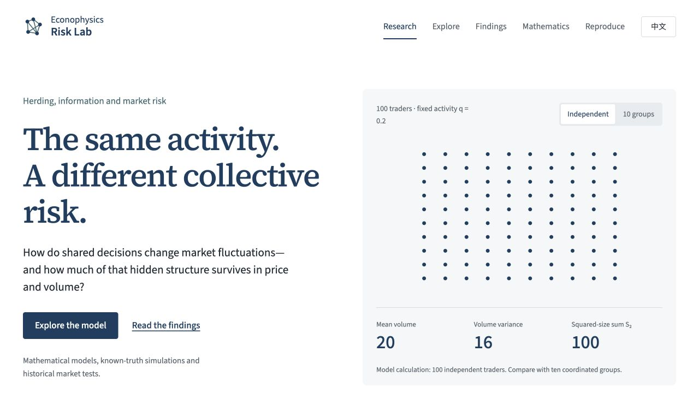
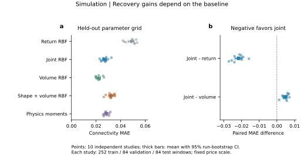

# Econophysics Risk Lab

Finite-network herding models, price–volume inference and historical risk analysis.

We study how coordinated trading enters market fluctuations, which model
parameters aggregate price and volume can identify, and whether the resulting
restrictions are compatible with observed markets. The project combines exact
moment calculations and finite random graphs with controlled simulations,
Bitcoin observations and sector-ETF risk diagnostics.

[Research website](https://safudarren.github.io/econophysics-risk-lab/) ·
[Interactive experiments](https://safudarren.github.io/econophysics-risk-lab/lab.html) ·
[Full research report](web/downloads/research-report-en.pdf)

[](https://github.com/SAFuDarren/econophysics-risk-lab/actions/workflows/checks.yml)
[](https://github.com/SAFuDarren/econophysics-risk-lab/actions/workflows/pages.yml)

[](https://safudarren.github.io/econophysics-risk-lab/)

[**Explore the interactive research website →**](https://safudarren.github.io/econophysics-risk-lab/)

## Research results

- **Exact moment relations and parameter recovery.** In the finite Erdős–Rényi
  (ER) model, price–volume moments identify activity, connectivity and positive
  price response when population size and unit order size are known. At fixed
  population size and price scale, finite-ER inversion and joint radial-basis
  regression achieve mean absolute errors of **0.0271** and **0.0269** on unseen
  connectivity values across ten studies.
  [Recovery source table](results/tables/depth_study_v1/summary_metrics.csv).
- **A structural identification limit.** The complete joint observation law
  depends on connected-group sizes. A four-node chain and star have identical
  price–volume laws, making their internal edges indistinguishable through these
  observations. [Mathematical foundations](docs/theory/FOUNDATIONS.md).
- **Bitcoin observations violate the fixed model’s joint-moment restriction.** The fixed group-action
  model requires a positive statistic Δ. BTCUSDT 2025 H2 gives **−8.181**, with
  an estimated 95% seven-day-block interval **[−11.998, −4.712]**.
  [Market test](https://safudarren.github.io/econophysics-risk-lab/findings.html#market).
- **An explicit historical forecast benchmark.** On **183 held-out dates**,
  HAR+All reduces log-MSE by **31.20%** relative to persistence. Its incremental
  reduction relative to HAR is **2.26%**, with an estimated 95% block interval
  **[−0.11%, 4.56%]**.
  [Forecast results and comparisons](https://safudarren.github.io/econophysics-risk-lab/findings.html#forecast).
- **Shared-risk and strategy-overlap diagnostics.** For the same nine-sector
  basket and 63-session window ending 31 March 2020, full and diagonal covariance
  estimates give annualized volatility of **57.73%** and **20.62%**. Two
  low-volatility strategy variants have daily net P&L correlations of **0.921**
  in 2020–2025 and **0.795** in the 2026 confirmation period.
  [Portfolio and strategy results](https://safudarren.github.io/econophysics-risk-lab/findings.html#applications).



*Parameter-recovery benchmark (D01), generated from the project’s controlled
simulation studies. Method comparisons are in the source table above; settings are in the [study configuration](configs/depth_study_v1.json).*

## Model and methods

Each observation period independently redraws a finite ER network of traders.
Every connected group shares a buy, sell or inactive action, independently of
other groups. The parameters satisfy $0<q<1$ and $\lambda>0$.
For the displayed graph $H$,

$$
\mathrm{Var}(r\mid H)=q(\lambda/N)^2S_2,
\qquad S_2=\sum_C s_C^2.
$$

Here $r$ is log return, $q$ the group activity probability, $\lambda$ the price
response, $N$ the population size and $s_C$ the size of group $C$.
The squared-size sum links microscopic coordination to aggregate fluctuations.

- **Forward model:** exact group moments, finite-ER connectedness recurrences and
  1,080 graph draws across $N=128,256,512$.
- **Inverse problem:** finite-size moment inversion, radial-basis regression,
  scale controls and characteristic-function equivalence arguments.
- **Market analysis:** price–volume compatibility tests, paired block comparisons
  for volatility forecasts, and matched-window covariance and daily P&L diagnostics.

[Full mathematical derivations](https://safudarren.github.io/econophysics-risk-lab/methods.html) ·
[Model specification](docs/AB/model_spec.md) ·
[Forecast protocol](docs/AB/forecast_contract.md)

## Code and reproduction

The core model and exact theory checks use the Python standard library:

```bash
python scripts/reproduce.py --profile quick
```

Three executable notebooks connect the implementation to the numerical results:

1. [Groups, moments and finite-size networks](notebooks/01_model_and_moments.ipynb)
2. [Inversion and identification limits](notebooks/02_inference_and_identity.ipynb)
3. [Market tests and historical forecasting](notebooks/03_market_and_forecasting.ipynb)

```bash
python -m pip install -e ".[analysis,notebooks]"
python scripts/reproduce.py --profile notebooks
python scripts/reproduce.py --profile site
```

The complete forecast reconstruction downloads the documented archives into a
fresh directory and compares rebuilt CSVs with the saved study tables:

```bash
python -m pip install -r requirements-study.txt
python scripts/reproduce.py --profile forecast --destination /tmp/forecast-rerun
```

The [validation record](docs/VALIDATION.md) documents the executed checks and
byte-identical reconstruction of all 16 forecast tables.

To preview the bilingual website locally:

```bash
python -m http.server 8000 --directory web
```

Open **http://localhost:8000**. The extended laboratory includes strategy screening,
all 63 nonempty strategy subsets and transaction-cost comparisons.

## Research outlook

Quantum models and quantum machine learning are possible extensions for collective
dynamics and risk inference. The choice of approach and timing will depend on
problem fit and a testable comparison with classical methods.

## Research materials

- [`src/econophysics/`](src/econophysics/): shared model, inference and analysis code.
- [`configs/`](configs/): study configurations.
- [`results/tables/`](results/tables/): numerical source tables and complete forecast outputs.
- [`data/manifests/`](data/manifests/): archive locations, checksums and provenance.
- [`docs/theory/`](docs/theory/): mathematical foundations and identification arguments.
- [`web/`](web/): bilingual website, experiments and scientific figures.

The [English report](web/downloads/research-report-en.pdf) and
[Chinese report](web/downloads/research-report-zh.pdf) contain 19 scientific
figures, eight tables and the subsequent control studies.
The notation $c$ corresponds to `rho` in the Python implementation;
activity $q$ equals twice the directional action probability `a`.

## Credits and reuse

Research is credited to the **Econophysics Risk Lab contributors**. Website and
repository maintained by **Darren Fu Shiang**. See [AUTHORS.md](AUTHORS.md).

Code, research materials, dataset-derived results and third-party assets have
separate terms. See [LICENSE.md](LICENSE.md) and [DATA_LICENSES.md](DATA_LICENSES.md).
Data-source manifests document the routes for acquiring the full price histories.
