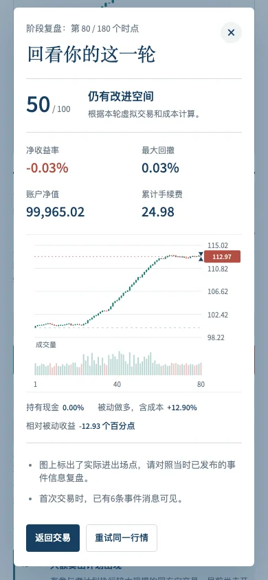

# Collective dynamics and trading lab: acceptance record

6 November 2026. Local implementation, numerical reproduction, independent scientific review and browser integration have passed. Publication/deployment is verified separately against the released commit and live URLs.

## Nine delivered tasks

| Task | Delivered evidence | Acceptance |
|---|---|---|
| M1 Effective trading weights | COLLECTIVE_DYNAMICS_MODEL_v1.md; exact weight/covariance controls | Pass: original independent law is recovered as a special case; units and assumptions are explicit |
| M2 Coupled networks and switching | trading-engine.js; collective_trading_v1.json | Pass: weighted fast/slow states, cross-layer influence and node flips; coupling-off control retained |
| M3 Memory, phases and horizons | Model trace and update equations; displayed current-state phases | Pass: phase uses current/past state only, slow update is conditional, no automatic periodic-cycle claim |
| V1 Mathematical and simulator controls | test_trading_engine.cjs; simulation tables; isolated engine reproduction | Pass: 384 paths over 32 seeds; four result tables reproduce byte-for-byte in the isolated run |
| V2 Information-budget study | studies/collective_dynamics_v1/ | Pass as an executed research comparison: eight numerical tables reproduce with zero difference; no information-efficiency/prediction advantage established |
| W1 Synthetic market engine | Same browser/CommonJS engine and deterministic configuration | Pass: causal events, prefix invariance, bounds and completed-path stability |
| W2 Trading interface | trading.html; trading-ui.js; trading.css | Pass: real module states, long/short, partial exits, costs, market controls and bilingual mobile layout |
| W3 Account, score and replay | trading-account.js; independent ledger review; browser end settlement | Pass: cash/equity and additive ledger identities, risk limits, costs, score rules and fair same-path benchmark |
| W4 Website integration | Research/Explore entry, mathematics, findings, reproduce and README | Pass: original preview retained; 7 pages and 208 local references checked; 22 browser integration checks |

## Executed checks

- Core quick profile: original mathematical foundations, nine Python research tests and JavaScript mathematical checks pass.
- Site profile: static resources/anchors, original numerical payload checks, source-bound displays, JavaScript syntax and original interactive regression checks pass. The new standard-library study check verifies49 source hashes,10,728 prediction rows, exact displayed values and saved chronology audits.
- Synthetic market:11 compound gates;384 retained full runs with32 independent seeds; no-cross-layer, no-memory, equal-weight and no-announced-program ablations. All outcomes retained.
- Account checks:10,857 assertions across deterministic and randomized long/short paths. An independent reviewer additionally examined54 cost/slippage/leverage combinations with partial closes, reopening and settlement.
- Browser acceptance:51 checks using actual DOM controls and mobile taps. Widths320,390,768,1440 have no horizontal overflow. Modal bounds and close buttons fit the actual viewport, not a misleading full-document screenshot position. Guided playback pauses on the newly revealed intent; the player resumes after deciding. Language/reset/settings/end settlement and observation after insolvency pass. No browser or HTTP errors.
- Cross-page browser integration:22 checks, desktop and phone. The new mathematics renders without KaTeX errors; all16 displayed primary QLIKE values match source tables. Existing advanced laboratory still loads.
- The complete matched-budget numerical study was rebuilt in a fresh directory with eight exact table matches. Parent review verifies the published copy's50 files against the sealed source snapshot. The study's own ready-for-parent-review record is retained unchanged; final parent scientific signoff is in results/checks/collective_round_independent_scientific_review_v1.json.

## Findings corrected during review

1. Per-trade realized-P&L originally mixed round-trip and portfolio-delta conventions, double-counting entry fees when summed. The additive ledger now matches the portfolio exactly; round-trip net P&L is a separate field. The independent rerun has zero ledger discrepancy.
2. The slow-layer heat-bath formula is conditional on an update attempt. The page now states the0.14 update probability and otherwise-retained state, matching the engine.
3. Highly skewed paired losses made percentile intervals and centred-bootstrap tests appear inconsistent. The study retains both definitions, adds null-compatible basic intervals and uses the latter in the paired-control figure; all Holm families independently recalculate.
4. Mobile heading width, current-intent visibility and modal layout were reviewed and improved. A near-chart event strip and guided pause make the advance message usable before execution.
5. Mid-round passive returns now use mark-to-market; completed-round passive returns include closing costs, matching the corresponding player-account state.

## Scientific outcome and interpretation

The simulation demonstrates specified weighted interactions, not a reconstructed market network. The separately estimated macro closure is a modelling approximation. At240 past days the mechanism QLIKE is0.260805 versus0.260792 for the same-map pressure AR and0.228191 for return-only HAR. There is no established incremental or information-efficiency advantage. These are previously viewed historical dates. The original model restriction and previous benchmark results remain unchanged.

The `turn` scene explicitly introduces an announced opposing program. It is not presented as proof of an endogenously predicted crash. A separate no-program ablation isolates background-node dynamics. Simulation scores describe that virtual round; they do not validate real-market profitability.

## Reproduction and evidence index

```sh
python scripts/reproduce.py --profile quick
python scripts/reproduce.py --profile site
node scripts/research/reproduce_collective_trading_engine.cjs
python -m pip install -r studies/collective_dynamics_v1/requirements.txt
python studies/collective_dynamics_v1/reproduce.py
```

Optional browser acceptance requires Playwright and a served web directory. Configure TRADING_BASE_URL, PLAYWRIGHT_MODULE_PATH, optional PLAYWRIGHT_CHROMIUM_EXECUTABLE and TRADING_QA_OUTPUT, then run tests/test_trading_browser.cjs and tests/test_collective_integration.cjs.

Machine-readable records are in results/checks/: collective_trading_engine_v1.json, collective_trading_engine_reproduction_v1.json, trading_account_independent_review_v1.json, trading_browser_v1.json, collective_site_integration_v1.json and collective_round_independent_scientific_review_v1.json. Complete numerical provenance and figure QA accompany the study. This account is an implementation acceptance record, not a declaration that the desired market prediction advantage was achieved.




## Playback and signal controls, revision 1.1

The market now defaults to four real seconds per tick (0.5×), with selectable 0.25×, 0.5×, 1×, 2× and 4×. A separate large-order signal panel has an accessible on/off switch. Hidden signals do not appear in the event tape or trigger guided pauses. Changing these controls preserves the generated price path and current account. Review counts only messages actually visible before the first trade, including when a switch is changed later on that same tick.

The dedicated controlled-clock browser acceptance passes 37 checks, covering the exact four- and eight-second intervals, timer changes, concurrent trading, hidden-message paths, first-trade information timing, keyboard operation and 320/390/768/1440-pixel layouts. The 51-check full trading browser regression and site profile also pass. This revision changes interaction timing and information display; it does not change the scientific model or numerical research results.

Run `node tests/test_trading_controls.cjs` with the same Playwright environment variables as the main browser test. Its source hashes and acceptance results are in `results/checks/trading_controls_v1.json`. Live deployment acceptance is recorded separately after publication.

## Original market replay, revision 1.2

The default workbench now replays nine original BTC/USDT excerpts; the synthetic engine is retained in the mechanism tab. The historical data package is studies/historical_replay_v1/. Its full 26-day pool is rebuilt from 52 checked official archives. All selected OHLC values exactly match raw Kline files, and every alert uses completed transactions and a lagged threshold. The selected primary movements are 2.09–6.52% over90minutes. This is retrospective teaching-case selection, not new evidence of predictive advantage.

The pure replay/account tests pass4,395 assertions. Historical browser acceptance passes59 checks, including every excerpt, long/short execution, outcome concealment until completion, source switching, signal visibility and four screen widths. The51-check original model-tab browser regression and the site profile pass. Passive historical comparison uses the playable starting close and excludes warm-up bars. The full source pool and all selection artifacts reproduce byte-for-byte. Source checks, raw reproduction and browser evidence accompany the historical package.

## Theory-linked historical debrief, revision 1.3

The completed-round review aligns actual prices/fills, observed large executions, conditional execution amplification and the local risk mapping on one cursor. Formulae and the source-information budget are explicit. Macro-only inversion is not claimed by this richer-execution diagnostic. The homepage, methods and README share the mechanism → observability → market test → risk-evaluation line; negative Δ and the lack of matched-budget prediction advantage remain part of it.

The numerical debrief has8,748 deterministic assertions across1,089 origins. Independent NumPy recalculation compares11,979 scalar values, with numerical agreement. Tests retain exact cancellation, pre-play calibration, known-prefix invariance and return-free G/model risk. All9 historical case selections are unchanged. The42-check dedicated browser suite verifies source labels, outcome locking, formula rendering, shared selection, bilingual continuity, mobile legibility and reachable close controls. The51-check original model regression and site reproduction pass. Historical source, selection and debrief traces rebuild independently; raw signed flow and size-square baselines are reaggregated from the official executions.
