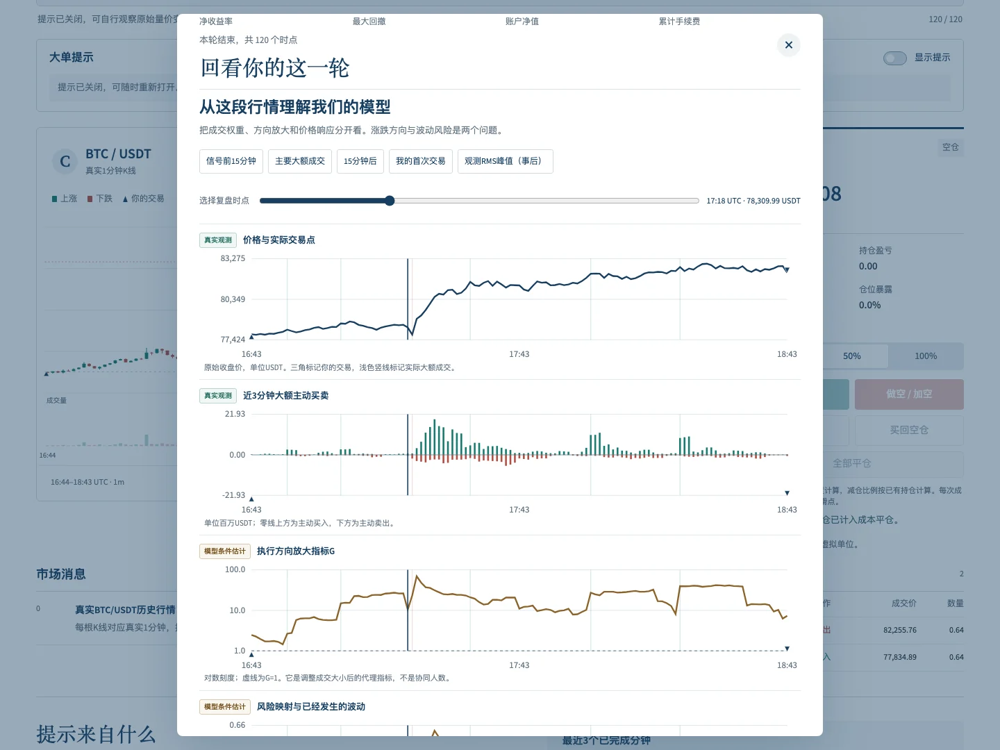
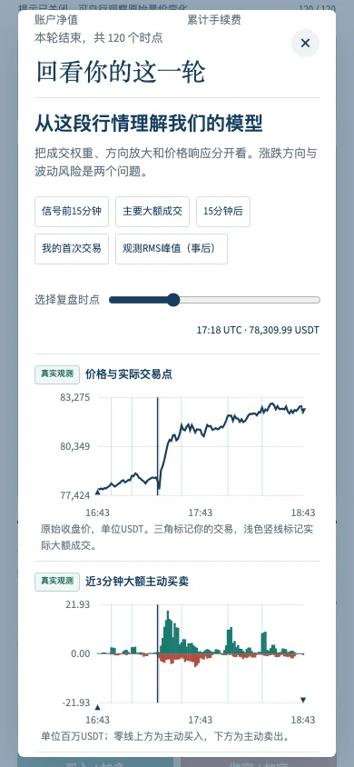

# From historical trading to mechanism diagnostics

The completed-round debrief aligns the actual price path and the player's executions with large aggressive flow, execution-direction amplification and a conditional risk map. Source badges distinguish observed data from model-conditioned quantities. Post-hoc navigation points are labelled separately.

## Observations and units

For each completed minute, aggregate executions supply base sizes v_i in BTC and aggressive-side signs ε_i. We measure signed aggressor flow F=Σ ε_i v_i and the size baseline B=Σ v_i² directly. The replay also retains large buy/sell quote amounts and the original OHLC prices. F is aggressor-volume imbalance; every trade still has both a buyer and a seller. It is not net market ownership or unopposed money entering a market.

B is measured using detailed aggregate executions in this diagnostic. The debrief therefore uses more information than a macro-only deployment. Estimating this baseline reliably from a smaller observable set remains a separate research task. Aggregate executions are not verified people or complete parent orders.

## The conditional index

The replay uses population-style centred moments over the last 15 completed minutes:

Ĝ(t)=Var₁₅(F)/mean₁₅(B).

Under independent symmetric execution directions, B is the conditional second-moment baseline. G is a dispersion-amplification proxy relative to it. A group-susceptibility interpretation requires extra mapping, mark and symmetry assumptions; order splitting or size–direction dependence can produce similar values. G is not direction: large buying and large selling can both produce amplification. Persistent one-sided trading may primarily shift mean flow without increasing centred G. No conversion to coordinating-person counts or real graph topology is made.

The exact identity mean₁₅(B)×Ĝ=Var₁₅(F) is preserved and tested. A same-window product creates no additional information.

## Local response and risk map

Before play, fit r=α+βF+η to exactly the 30 completed minute pairs at ticks −29 through 0, with β≥0, an intercept, and the mean squared fitted residual. Coefficients remain frozen during the playable interval. No subsequent price return is used to calibrate the map or calculate G.

At each origin t, use three-minute activity b₃=mean₃(B), 15-minute mean flow m₁₅, and the 15-minute G:

ĥ(t+1|t)=(α+βm₁₅)²+β² b₃ Ĝ+σ²η.

The displayed risk scale is 100√ĥ percent per minute. It is a conditional RMS estimate, includes the mean-return energy, and is not the centred conditional standard deviation. Response stability, residual orthogonality/moments and persistence of recent flow statistics are assumptions. The 3/15-minute separation is a local explanatory version of the fast-activity/slow-amplification hypothesis; it is not the previously evaluated daily benchmark model.

Two controls are retained:

- Set G=1 while holding the mean/response/residual terms fixed. This is a model reference, not the causal effect of removing actual coordination.
- Use b₁₅ instead of b₃. The flow term then equals β² Var₁₅(F) exactly, matching the direct-flow control. Any potential forecasting content must come from a useful persistence/transition rule or cheaper measurement, not factor naming.

The observed risk curve is trailing 15-minute realized RMS of minute returns. The model curve is the next-minute RMS estimated at each plotted origin. These have distinct targets. At a selected origin, the next realized absolute return is shown only if that candle exists in the known prefix; it is a single realization, not a volatility estimate or a calibration test.

## Teaching sequence

1. Inspect the real price and your entries/exits.
2. Locate observed large buying/selling and distinguish direction from size.
3. Inspect B and conditional G; ask whether the baseline or amplification changed.
4. Compare the risk map, its G=1 reference and already realized fluctuation.
5. Examine mismatches as evidence about response, residual and persistence assumptions.
6. Return to the synthetic model to change interaction/memory, or read the matched-budget Bitcoin comparison.

The complete mechanism view opens after the final candle, including for rounds played with hints disabled. It does not retrospectively change the recorded information available at a player's first trade. Full execution information is used for explanation after play. Dates and observed-RMS peaks are post-hoc context, not advance signals.

## Validation

The deterministic mathematics tests check same-window cancellation, risk-map contrasts, nonnegative moments, pre-play-only calibration, prefix invariance and missing next returns. Perturbing post-play returns changes observed fluctuation but cannot change conditional G or the model risk series. An independent NumPy implementation recalculates all 1,089 origins. The raw source aggregation independently reconciles signed base flow to official taker-buy base volume and measures squared execution sizes.

The excerpts were selected after observing large subsequent moves. These plots establish neither forecasting skill nor information efficiency. The separate matched-budget study remains the evidence for that question and currently finds no advantage.

