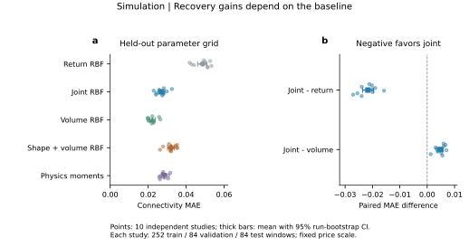
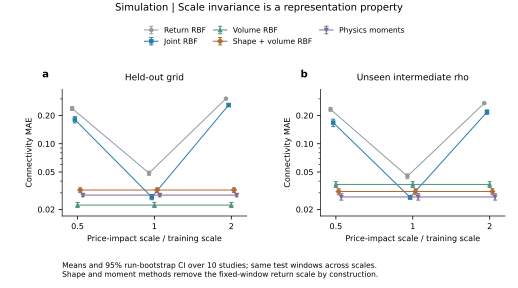
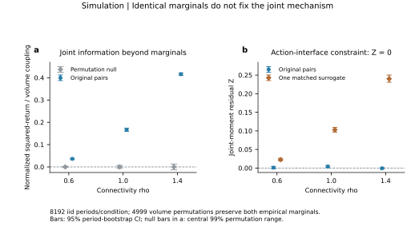

# 1. 核心结论：估计参数与验证机制需要不同证据

**本轮成果将项目从一次量价分类比较，推进到有限规模物理反演、独立训练重复、尺度稳健性与机制相容性检验。**所有新数字来自指定模型的模拟；没有真实市场或量子优势结论。

第一，量价 RBF 相对仅收益的增益在 10 次独立研究中重复出现，平均 MAE 从 0.048660 降至 0.027013，下降 44.49%。但仅成交量 RBF 在同一网格上达到 0.022196，10 次均优于量价组合。因此，组合有效不等于组合必然最优。

第二，由经典有限图连通递推得到的物理矩估计器，不使用监督标签；在未见中间参数点上 MAE 为 0.027114，接近量价 RBF 的 0.026882。误差差的描述区间包含零，不是性能等价证明。学习器退步不能直接解释为观测缺信息。

第三，统一改变窗口内价格响应尺度时，原始量价 RBF 明显失效；尺度不变表示及物理矩方法保持不变。这是指定变换下可证明、已核验的性质，不是对所有市场变化的稳健性保证。

第四，置换同期成交量精确保留收益、量各自的经验分布，却破坏联合矩关系。模型检验需要联合证据；但排除独立配对这一替代解释，仍不等于唯一识别羊群机制。

本轮新数据：10 次完整独立研究、4,920 个独立窗口、每窗 256 期，共 1,259,520 个模拟区间。每次包含 252 训练／84 验证／84 测试窗口，另有 72 个训练未见的 rho 中间值窗口。活动率有三种取值；N=128、u=1 固定。

**文献定位。**Cont–Bouchaud 提供协调骨架；Gilbert 提供有限图递推；Platt 与 Platt–Gebbie 推动校准和机制验证分开；Clauset 等要求尾部假设可检验；Lux–Marchesi 和 JLS 用于解释适应反馈与泡沫风险。它们共同决定研究设计，而不是事后给图配引用。完整映射见[文献综合](../../../docs/AB/literature_synthesis.md)。

\newpage

# 2. 理论推进：从可识别到可计算、可检验

令 $q=2a$，$S_j=\sum_i s_i^j$。已知 N、u 时，量的总体均值与方差识别 q 和 E S2；ER 家族内 E S2 随 rho 严格增加。

[Gilbert（1959），式 (4)](https://www.stat.cmu.edu/~brian/780/bibliography/09%20Other%20Models/Gilbert%20-%201959%20-%20Random%20graphs.pdf) 给出有限图连通递推。以 C_s 表示 G(s,p) 连通概率：

$$C_s=1-\sum_{k=1}^{s-1}\binom{s-1}{k-1}C_k(1-p)^{k(s-k)},\quad C_1=1.$$

指定节点所属群体大小的概率为

$$\pi_{N,s}=\binom{N-1}{s-1}C_s(1-p)^{s(N-s)},\qquad
A_N(\rho)=N\sum_s s\pi_{N,s}.$$

由此建立有限 N 的矩估计参照：

$$\widehat q=\overline V/(uN),\quad
\widehat A=\frac{s_V^2}{\widehat q(1-\widehat q)u^2},\quad
\widehat\rho=A_N^{-1}(\widehat A).$$

概率表达精确；实际计算用 380 位十进制，另以 460 位及小图全枚举核对。求逆使用步长 0.025 的密集曲线；五个额外中点的插值误差最大约 0.000359。不是所有点的统一误差上界。1,560 个测试／插值窗口均未触发边界处理。

**另一条推进是不依赖 ER 的约束。**任意群体分布下，共同动作接口给出

$$\kappa_3(V)=u^3q(1-q)(1-2q)\mathbb E S_3,$$
$$\operatorname{Cov}(r^2,V)=u(\lambda/N)^2q(1-q)\mathbb E S_3.$$

消去群体矩和尺度后，得到无量纲残差

$$\mathcal Z=(1-q)\frac{\kappa_3(V)}{uN\operatorname{Var}(V)}
-(1-2q)\frac{\operatorname{Cov}(r^2,V)}{uN\operatorname{Var}(r)}=0.$$

它检验动作与聚合接口的相容性，不唯一识别图族或临界状态。q=1/2 时三阶约束退化。一般证明、尺度不变性及文献模型比较见[理论增补](../../../docs/theory/DEPTH_ADDENDUM.md)。

\newpage

# 3. 重复研究：量有用，但要选对比较对象



同训练尺度下，表中为 10 次独立研究的平均 MAE。每次的训练、验证、测试数据均重新生成；物理估计器无需监督训练。

| 方法 | 原参数网格 | 未见中间 rho |
|---|---:|---:|
| 仅收益 RBF | 0.048660 | 0.045077 |
| 量价 RBF | 0.027013 | 0.026882 |
| 仅成交量 RBF | 0.022196 | 0.036849 |
| 尺度不变量价 RBF | 0.032106 | 0.031013 |
| 物理矩反演 | 0.028372 | 0.027114 |

量价相对收益的平均配对差为 −0.021647，95% run-bootstrap 区间 [−0.023615,−0.019642]，10/10 次获胜。量价相对仅量的平均差反而为 +0.004818，10/10 次较差。两项符号检验经三项 Holm 校正后的 p 均为 0.005859；它们检验获胜概率，不等于对平均误差的同一个检验。

**关键解释：**成交量总体上足以识别 rho，不等于它是统计学意义的充分观测，更不保证某个量特征学习器最优。仅量 RBF 在未见参数上退步，而量的物理反演没有同样退步；不能据此把前者的问题归因于信息不足。物理反演与量价 RBF 的接近也不能据此宣布等价。

\newpage

# 4. 稳健性：可以通过表示消除明确的干扰



对每个同一测试窗口统一令 $r\mapsto br$，b=0.5、1、2；V 保持不变。三种尺度是配对变换，不是三份独立测试集。

| 方法 | 原尺度 MAE | 双倍价格响应 MAE |
|---|---:|---:|
| 仅收益 RBF | 0.048660 | 0.302249 |
| 量价 RBF | 0.027013 | 0.258133 |
| 仅成交量 RBF | 0.022196 | 0.022196 |
| 尺度不变量价 RBF | 0.032106 | 0.032106 |
| 物理矩反演 | 0.028372 | 0.028372 |

新表示将平均绝对收益和两个分位数除以收益标准差，并删除标准差本身，保留量和幅度量相关。由 $\Phi(br,V)=\Phi(r,V)$，固定学习器输出也不变；全部测试预测的尺度不变性已经核验。

双倍冲击下，新表示相对原始量价 RBF 的平均误差下降 87.56%，10/10 次改善；无漂移时却较差。这是信息取舍：丢弃尺度提高指定干扰下的稳健性，也可能失去有用的参数信息。

**物理参照还估计其他参数。**原网格上活动概率 q 的 MAE 为 0.006442，价格响应 lambda 的平均绝对相对误差为 3.10%。这些值同样依赖已知 N、u 和指定成交接口。窗口内逐期变化的流动性、非线性冲击、人数或订单单位变化均未验证。

\newpage

# 5. 机制检验：相同边际可以对应不同同期耦合



使用已冻结的三个 8,192 期 iid 模拟序列。将 V 随机置换，而 r 不变，因此两种边际经验分布、各自所有分位数与尾部统计完全相同。

定义耦合量 T=Cov(r²,V)/(Var(r)uN)。原始配对的 T 分别约为 0.0362、0.1668、0.4158；置换零分布靠近零。每种条件 4,999 次置换的单侧 p=0.0002，三项 Holm 后为 0.0006。

| rho | 原始约束残差 Z | 一个边际匹配置换样本的 Z |
|---|---:|---:|
| 0.6 | 0.001058 | 0.022686 |
| 1.0 | 0.003838 | 0.102860 |
| 1.4 | −0.000719 | 0.240025 |

**必须保留的偏离：**旧 rho=1 序列的残差名义 95% bootstrap 区间为 [0.000903,0.006984]，不含零；不能把所有原始样本都写成“完美通过”。随后利用本轮已生成的 10 次独立研究，每个条件每次 5,120 期，追加检查平均残差。三种 rho 的均值区间都包含零；其中 rho=1 为 [−0.000644,0.002227]。追加性质已记录，没有搜索新种子。

这说明模型约束有有限样本波动，也说明边际保真替代与原始联合关系存在明显差别。置换检验排除的是同期独立配对，不是全部替代金融机制；在远离临界点时也能拒绝独立，所以它不是临界性检测器。

\newpage

# 6. 与论文结合：把“临界性”拆成不同科学对象

[Platt–Gebbie](https://arxiv.org/html/1606.01495v4) 在具体金融 ABM 中展示，复现部分风格化事实与校准困难可以并存；[Platt](https://arxiv.org/html/1902.05938v1) 则用已知参数的计算实验比较校准质量。我们因此分别报告机制约束、参数恢复和独立重复，没有把高精度恢复等同于机制正确。

| 模型 | 交互与反馈 | 对本项目的用途 |
|---|---|---|
| Cont–Bouchaud 骨架 | 当期群体共同动作 | 可解析的协调与聚合基线；明确活动率和尾部范围 |
| Lux–Marchesi | 趋势、群体意见、利润差驱动策略转换 | 解释适应性、内生时间结构与暂时失稳 |
| JLS 泡沫模型 | 自增强模仿与崩盘风险率相联系 | 说明动态风险、条件价格增长和随机崩盘时间 |

[Lux–Marchesi（1999）](https://www.nature.com/articles/17290) 的动态稳定性问题，不能被本组逐期独立 ER 网络替代。我们没有声称已经产生波动聚集或泡沫积累。

[JLS，arXiv v2](https://arxiv.org/abs/cond-mat/9810071v2) 在简化鞅设定下有

$$dp/p=\mu(t)dt-\kappa dj,\quad \mathbb E[dj]=h(t)dt
\quad\Longrightarrow\quad \mu(t)=\kappa h(t).$$

未崩盘路径的 log 价格是风险率的积分。若再假设 $h(t)\propto(t_c-t)^{-\alpha}$、$0<\alpha<1$，就得到条件价格加速的形式。这是文献模型的假设与推导，不是本组预测实验；临界时间不等于确定崩盘日期。

**综合结论：**ER 渗流临界性描述群体几何；动态适应模型描述稳定性和时间结构；泡沫模型描述随时间演化的风险。共同使用“临界”一词不能把三者当成同一个参数。我们保留可分析的核心，用文献解释其覆盖范围，并把真实检验作为下一步。

\newpage

# 7. 证据、复现与允许的最终主张

本轮 155 项方法检查通过，含小图独立枚举、精确分数三阶矩恒等式、尺度表示检查。另从全部 1,259,520 条原始观测重建 4,920 个特征窗口，重新选参和训练 10 次，复现 23,400 个测试预测；最大差约 $3.6\times10^{-14}$。程序复现不能代替成员科学复核。

允许的最终表述是：**在已知观测接口的有限 ER 羊群模型中，我们建立了可计算的物理参数反演，用独立重复验证观测增益与稳健性，并展示边际拟合不足以替代联合机制检验。结构观测等价仍限制一般网络恢复。**

不作真实市场网络恢复、普遍幂律、崩盘预测或量子优势主张。原理论中的一般图混合不可识别证明不因本轮更好的参数估计而消失。

实际复跑入口：

```sh
python3 scripts/run_depth_study.py --run-id depth_study_new
python3 scripts/check_depth_methods.py
python3 scripts/audit_depth_study.py
```

第一条使用新 ID 保留原证据；审计、机制检验、汇总和绘图脚本也接受同样的 run-id。上面后两条默认核对 depth_study_v1。所需依赖沿用 requirements-study.txt 与 requirements-figures.txt。完整步骤见本轮交接。

文献原文位置、版本和用途见[七篇来源综合](../../../docs/AB/literature_synthesis.md)；完整统计见[统计附录](stats-appendix.md)；逐图证据见[图表目录](figure-catalog.md)。

## Claim Candidates

- **稳定的量增益：**新原网格上 joint 相对 return 10/10 次改善；只限该任务、模型与训练预算，不推广为组合普遍优于 volume。
- **物理参照有竞争力：**未见 rho 的平均 MAE 接近 joint；描述区间不构成等价或最优性证明。
- **尺度干扰可设计消除：**只针对正的窗口统一乘法；没有真实市场制度变化保证。
- **联合约束增加验证能力：**能排除独立配对这一替代；不能唯一确定羊群、图族或临界状态。

状态：ready_for_review。真实数据、CD 演示整合、最终 GitHub 与成员签收仍待完成。
