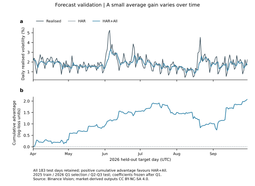
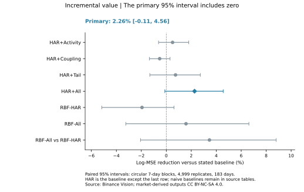
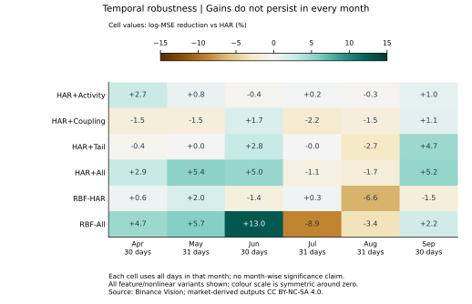
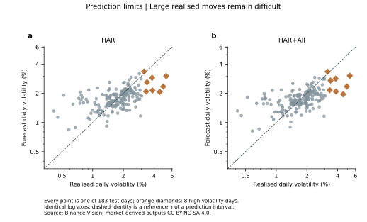
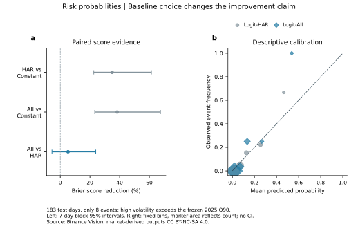

# 下一日波动预测：量价信息带来多少改善？

Econophysics Risk Lab · forecast_v1 · 2026-10-27 · REAL_DATA · 待成员科学复核

## 1. 结果：预测有价值的迹象，量价增量仍不确定

**已完成一次预先冻结、按时间划分的真实市场预测实验。** 使用 2025 年训练、2026 Q1 选参、Q2/Q3 最终检验。预测目标是下一 UTC 日内 5 分钟收益平方和；不是涨跌方向、价格点位、真实网络参数或崩盘。

| 比较 | 最终 log-MSE | 误差下降 |
|---|---:|---:|
| 昨日延续：明天方差等于今天 | 0.712561 | 参照 |
| 多尺度历史波动 HAR | 0.501565 | 相对昨日延续 29.61% |
| HAR 加全部量价/形状特征 | 0.490213 | 相对昨日延续 31.20% |

后两项相对昨日延续的百分比是同一最终样本上平均损失的算术对照。**量价的增量必须与 HAR 比较：主损失下降 2.263%，7 天块 95% 区间 [-0.115%, 4.559%]。** 配对损失差为 -0.011352，区间 [-0.022585, 0.000550]；近似原始 p=0.0564，九项比较 Holm 后 p=0.3948。因此不能称为已确认的稳定优势。

All 同时加入成交信息与收益形状，2.26%不是纯成交量归因。事后追加的更严格输入对照 All vs HAR+Tail 点改善为 **1.535% [-0.113%, 3.273%]**，同样未显示稳定优势；该项明确为描述性追加，不冒充预设主检验。

| HAR+All 相对 HAR | 点改善 | 7 天块 95% 区间 |
|---|---:|---:|
| 主损失 log-MSE | 2.263% | [-0.115%, 4.559%] |
| 补充损失 QLIKE | 0.120% | [-2.849%, 3.133%] |
| 日波动幅度 MAE | 1.644% | [-0.135%, 3.400%] |

概率模型相对冻结历史发生率的 Brier 分数下降 38.35%；但相对只用历史波动的概率模型，仅下降 **5.24%，区间 [-5.59%, 23.91%]**。不能把前者全部归因于量价。最终只有 8 个高波动日，不能声称罕见事件概率已经稳定校准。

这轮将研究研究推进到一个可复现的风险预测案例，同时量化了两个不同问题：历史多尺度信息是否有用，以及新增量价信息能多贡献多少。量价增量小且不确定、不同月份/状态表现不同，是必须保留的结果。

<!-- pagebreak -->

## 2. 时间协议、公式与机制联系

总计 183,744 根行情、638 个完整 UTC 日。28 日历史窗口后，可用训练目标 337 日，验证 90 日，最终测试 **183 日，2026-04-01 至 09-30**。新增 2026 行情为 78,624 根；缺失、重复、删除和填补均为零。配置与契约先于 2026 归档下载冻结。

定义观测和预测目标：

$$r_{d,j}=\log(C_{d,j}/C_{d,j-1}),\quad RV_d=\sum_{j=1}^{288}r_{d,j}^2,\quad z_{d+1}=\log RV_{d+1}.$$

在 d 日最后一根 K 线完成后预测 d+1。主回归在 log 尺度训练：

$$\widehat z_{d+1}=b+w^Tx_d,\qquad
\widehat w=\arg\min_w\sum_{d\in train}(z_{d+1}-b-w^Tx_d)^2+\alpha\|w\|^2.$$

HAR 输入为 $\log RV_d,\log\overline{RV}_{d,7},\log\overline{RV}_{d,28}$，均包含 d 日及更早观测。7/28 日是针对全天候市场的多尺度改编，并非逐项复刻原论文。标准化只用拟合期；截距由目标中心化实现，验证选择 alpha，最终训练加验证重新拟合一次，测试期系数固定。

| 增量组 | 特征 | 机制联系与边界 |
|---|---|---|
| Activity | 日总量的 log；相对 7 日均量的 log | 活动水平和状态变化，不是流动性深度 |
| Coupling | 日内幅度/量秩相关；无量纲平方收益/量协变；绝对主动成交失衡 | 联合活动和价格反应，不等同真实羊群参数 |
| Tail | 标准化四阶集中度的 log；最大单根平方收益占比 | 日内极端波动集中，不把它估成普适尾指数 |

原研究模型给出 $\operatorname{Var}(r)\propto\mathbb E\sum_i s_i^2$ 及量价联合矩；它激发这些可观测量的比较。真实接口已受到前轮检验挑战，因此本轮没有把物理矩反演的 rho 直接当作真实标签或预测因子。

除岭回归消融，还保留 RBF 核回归历史/全输入对照、昨日延续和 EWMA。全部候选、预算、损失及图形契约见[冻结协议](../../../docs/AB/forecast_contract.md)。

<!-- pagebreak -->

## 3. 完整时间轨迹：改善不是每天都发生

图 a 展示全部 183 个最终目标日，没有选择最有利的事件窗口。纵轴为 $100\sqrt{RV}$，单位为百分比；它度量日内路径波动，不等于当天收盘涨跌或最高最低价差。预测是点预测，没有虚构预测区间。

图 b 为累计优势：

$$A_D=\sum_{d\le D}[L_d(\mathrm{HAR})-L_d(\mathrm{HAR+All})].$$

曲线上升表示这一段完整特征模型损失较低，下降表示 HAR 较低。最终累计优势约 2.0774，对应平均损失差 0.011352；不能把每天同号作为前提。曲线是配对损失的完整路径，不是收益曲线，也不代表可交易盈利。

所有最终日都在固定拟合参数下评价；已发生的测试日可作为后续日历史输入，这是合法的顺序预测。它们未进入重新拟合、超参数选择或特征标准化。

**可支持：**本样本完整模型平均 log 损失点估计较低；优势随时间变化。**不能支持：**每日稳定胜出、已准确预告所有大波动，或概率/区间已充分校准。

<!-- pagebreak -->

## 4. 改善的量化：强基线改变结论

主比较同为岭回归、同一时间划分、同一验证损失。特征数不同但每种 Ridge 的 alpha 网格相同；RBF 是补充同方法输入对照，不能因其结果改写主方法。

$$L_{\log,d}=(\log RV_d-\widehat z_d)^2,\qquad
\mathrm{Skill}=100\left(1-\frac{\overline L_{model}}{\overline L_{baseline}}\right).$$

| 方法 | 最终 log-MSE | 相对 HAR 改善 |
|---|---:|---:|
| HAR+Activity | 0.499040 | 0.50% |
| HAR+Coupling | 0.504224 | -0.53% |
| HAR+Tail | 0.497853 | 0.74% |
| HAR+All（预设主方法） | 0.490213 | 2.26% |
| RBF-HAR | 0.511316 | -1.94% |
| RBF-All | 0.493639 | 1.58% |

RBF-All 相对 RBF-HAR 的点改善 3.46%，区间 [-2.06%, 8.80%]；更复杂模型未带来已确认的增量。单一活动、联合或尾部组也未显示稳定独立优势。完整组合点估计较好不证明各组不可替代，也不证明某个微观机制是原因。

为避免将收益形状增益归给成交量，另表追加 All vs HAR+Tail 的描述性配对结果。原15张主分析表及预设比较族不改，追加表和理由完整保留。

图中区间为 4,999 次配对圆形 7 日块分位；1/14 日敏感性中主区间也均跨零。主结果不是由于选了一个最有利的块长度。

<!-- pagebreak -->

## 5. 时间异质性：平均值不能代替稳定性

每格为该月全部日期上的相对 HAR log-MSE 改善。完整方法六个月分别为 **2.90%、5.41%、4.99%、-1.12%、-1.71%、5.15%**，四个月为正、两个月为负。月份只有 30/31 日，且共用同一拟合模型，这些是描述性拆分，不是六次独立显著性验证。

还按训练期 RV 的 25%、50%、90% 分位，预先定义四种事后目标状态：

| 最终实际 RV 所在训练阈值区间 | 日数 | HAR+All 相对 HAR 改善 |
|---|---:|---:|
| 低于 Q25 | 49 | 3.83% |
| Q25 至 Q50 | 51 | 10.35% |
| Q50 至 Q90 | 75 | -1.92% |
| 高于 Q90 | 8 | -3.11% |

这些分层使用已实现的目标，只用于解释误差，不能提前挑选明天所属状态，也不能据此设计已验证策略。高波动组只有 8 日；现有结果不支持“量价主要改善极端日预测”。

**可支持：**点改善具有时间与状态异质性，不能用一个百分比替代完整表现。后续机制研究可围绕活动状态和价格响应变化设计新预测，但需要新的冻结与未用检验。

<!-- pagebreak -->

## 6. 点预测的局限与评价损失

两个面板均保留 183 日，使用同一正值 log 坐标。橙色菱形为超过训练 Q90 的 8 日。大幅实际波动仍可能超出点预测，这不能单凭散点图判成条件预测有偏；点预测本来不应被理解成实现值上界。

补充损失检查不同误差代价：

$$L_{Q,d}=\frac{RV_d}{\widehat{RV}_d}-\log\frac{RV_d}{\widehat{RV}_d}-1,\quad
L_{\sigma,d}=100|\sqrt{RV_d}-\sqrt{\widehat{RV}_d}|.$$

HAR 与完整模型的 QLIKE 分别为 0.234214、0.233933；波动 MAE 为 0.440987、0.433735 个百分点。主损失点改善没有在 QLIKE 上体现为同等幅度。由于模型训练 log-MSE，$e^{\widehat z}$ 是 log 尺度预测的正值变换，不保证为条件算术均值；未做事后偏差修正优化最终指标。

RV 是由观测收益构造的波动代理，不是可直接读取的潜在连续方差。QLIKE 的理论动机见 Patton，不能因此宣称任意代理噪声或市场非平稳下的比较均自动有效。

<!-- pagebreak -->

## 7. 高波动概率：大改善必须说清参照

固定训练期阈值 $H=Q_{0.9}(RV_{2025})=0.00100567$，对应日内波动幅度约 3.171%。定义

$$Y_{d+1}=\mathbf1\{RV_{d+1}>H\},\quad
\widehat p_{d+1}=\frac1{1+e^{-(b+w^Tx_d)}},\quad
BS=\frac1D\sum_d(\widehat p_d-Y_d)^2.$$

| 概率方法 | Brier 分数 | 含义 |
|---|---:|---|
| 冻结历史发生率 | 0.048270 | 拟合期发生率 12.41%，所有测试日相同 |
| Logit-HAR | 0.031405 | 只用历史波动，验证选 C |
| Logit-All | 0.029761 | 加全部特征，同样按验证 Brier 选 C |

All 相对固定历史发生率下降 38.35%，7 日块区间 [23.22%, 67.50%]；相对 HAR 概率模型只下降 **5.24% [-5.59%, 23.91%]**，Holm 后近似 p=0.3374。大改善包含动态历史波动与参照发生率失配的作用，不能当作成交量单独贡献。

最终发生率为 8/183=4.37%，明显低于拟合期；固定常数不是适应状态变化的强基线。图 b 固定概率箱显示的点为描述性频率，点面积反映箱内日数。All 最低箱 133 日没有事件，最高两箱分别仅 4、2 日；这不能证明低概率事件不可能，也不能证明高概率端已充分校准。

这是“高波动日”概率，不能改称崩盘或大跌概率。没有完成仓位规则、成本、风险预算或实盘收益评价。

<!-- pagebreak -->

## 8. 科学结论、复现与汇报口径

本轮采用多尺度 HAR 改编、岭回归消融、RBF 核回归、逻辑回归、验证选参、完全顺序的最终日期、配对块区间、多重比较与状态拆分。它检验真实市场的可用预测信息，不唯一识别微观机制。

| 汇报可说 | 不应写成 |
|---|---|
| 完整模型相对昨日延续的主误差点估计下降 31.20% | 量价或羊群机制贡献了 31.20% |
| 量价相对 HAR 的点改善为 2.26%，区间跨零 | 已确认显著、稳定超过强基线 |
| 高波动概率相对固定发生率评分较好 | 已准确预测崩盘或保证降低损失 |
| 平均效果存在月份和状态差异 | 每个月、极端时段都改善 |
| 原机制研究可帮助构造与检验量价表示 | 预测增益证明真实市场处于临界网络 |

独立审计 **699 项通过**：重读新增全部 78,624 根原始行情；重建收益；检查日期、未来特征扰动与目标划分；直接解岭回归正规方程核验五组模型，最大 log 预测误差约 $3.6\times10^{-15}$；逐项核对损失与概率。它们证明实现一致性，不替代成员科学复核。

复现入口、完整源码、配置、逐日预测及检查均随新批次交付；原始完整行情不随包复制，可由官方归档重建。数据与衍生结果署名 Binance Vision、CC BY-NC-SA 4.0。旧研究包保持原样。

本实验仅一个资产/场所、一次 183 日历史留出、固定训练方案；区间条件于拟合模型与所选日期块近似，没有证明跨市场泛化、风险资本充分性或投资决策效益。不得在看过最终结果后重选特征/月份再沿用同一“最终测试”称号。

方法与来源：[冻结配置](../../../configs/forecast_v1.json)、[统计附录](stats-appendix.md)、[图表目录](figure-catalog.md)、AB 交接（原内部交接记录）。

- Corsi (2009), *A Simple Approximate Long-Memory Model of Realized Volatility*：[作者机构条目](https://search.usi.ch/index.php/en/publications/1448)，[DOI](https://doi.org/10.1093/jjfinec/nbp001)。本轮为多尺度思想的 7/28 日改编；出版页全文获取受限，不声称逐项复刻论文实验。
- Andersen et al., *Modeling and Forecasting Realized Volatility*：[NBER 工作论文](https://www.nber.org/papers/w8160)。用于已实现波动预测的研究定位，不以其结果代替本次验证。
- Patton (2011), *Volatility forecast comparison using imperfect volatility proxies*：[作者机构记录](https://scholars.duke.edu/publication/792433)，[作者公开原文](https://public.econ.duke.edu/~ap172/Patton_vol_proxies_JoE_2011.pdf)。用于损失与波动代理的限制。
