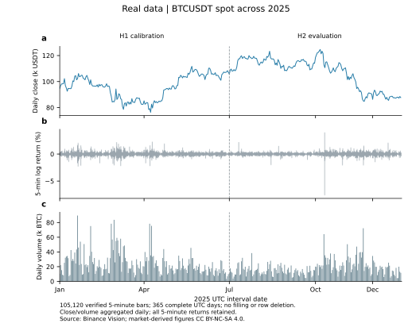
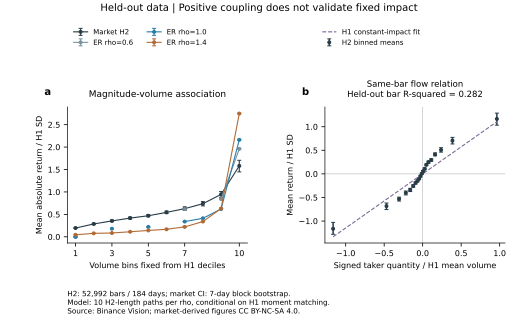
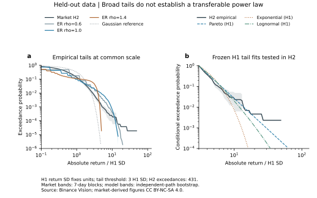
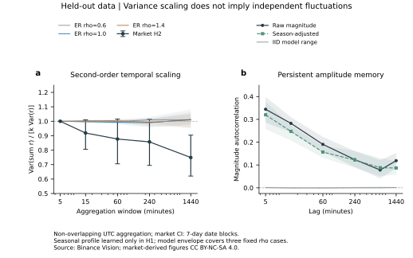
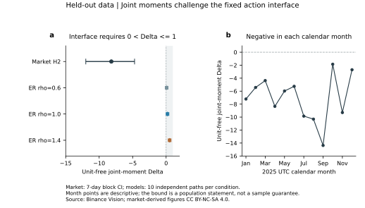

# 真实市场对照：量价、尾部、标度与模型边界

PC5253 · AB · real_market_v1 · 2026-10-27 · 待成员科学复核

## 1. 结论：模型解释了部分现象，固定接口未通过联合检验

**已完成全年真实市场数据与模型的留出对照。证据支持量价关联、厚尾和波动聚集；不支持把这些现象直接解释成已识别的临界羊群网络。** 更强的发现是：固定活动率、固定订单单位与固定价格响应的共同动作接口，在本样本上不能同时解释收益和成交量的联合矩。

对象为 Binance Vision 的 BTCUSDT 现货，2025 年全年 5 分钟数据，共 **105,120 根**。上半年 H1 校准，52,128 根；下半年 H2 留出，52,992 根、184 天。12 个月均完整；缺失、重复、无效 OHLC 和无效成交量均为零，没有填补或删除行情。

| 问题 | H2 证据 | 可支持的结论 |
|---|---|---|
| 量与价格波动是否关联？ | 幅度与量的秩相关 0.498；季节调整后 0.481 | 活动与波动幅度正相关 |
| 尾部是否为稳定幂律？ | 固定阈值下 Pareto 相对评分最好，但 H1 拟合未通过 H2 校准 | 厚尾；不能确认稳定、普适幂律 |
| 时间结构是否近似独立？ | 幅度滞后一期相关 0.344；调整后 0.320 | 存在幅度记忆；独立重采样模型缺少时间机制 |
| 换一个网络就能修好模型吗？ | 网络无关约束要求 $0<\Delta\le1$；市场估计为 $-8.181$ | 在其余接口前提不变时，仅更换拓扑不足 |

本轮生成 **3 个固定网络条件 × 10 条独立模拟路径，共 1,589,760 个模拟区间**。模型仅用 H1 的三个低阶矩校准，没有用 H2 挑选网络参数，也没有拟合真实网络标签。

市场区间采用日期块自助法；主分析为 7 天块，另报告 1 天块敏感性。这是依赖与非平稳数据下的近似不确定性分析。模拟区间条件于 H1 点校准，不能与市场区间混作同一种误差。

**研究推进。** 先前模拟说明“模型内部可以怎样估计参数”；本轮说明“估计之前，真实数据是否满足模型接口”。我们得到的是可检验的机制边界，尚未得到真实临界状态、真实拓扑或崩盘预测。

<!-- pagebreak -->

## 2. 数据与校准：先冻结比较口径

收益为 $r_t=\log(C_t/C_{t-1})$，量为同一根 K 线的 BTC 成交量 $V_t$。首根收益使用 2024-12-31 23:55 UTC 的前收盘价。保留 OHLC、USDT 成交额、交易笔数、主动买入量等字段；5 分钟以内的逐笔路径与盘口不在数据内。

模型设 $N=128$，固定 $\rho=0.6,1.0,1.4$；每个条件分别校准活动概率 $q$、订单单位 $u$ 和价格响应 $\lambda$，使 H1 的均量、量方差、收益方差相同。有限规模群体矩用既有高精度递推计算。三个不同网络条件均能匹配这三个矩，说明这组校准目标不足以挑选网络；这不证明完整量价分布等价。

| 固定 $\rho$ | 活动概率 $q$ | $u$（BTC） | $\lambda$ |
|---|---:|---:|---:|
| 0.6 | 0.00845 | 77.771 | 0.12073 |
| 1.0 | 0.02847 | 23.076 | 0.03546 |
| 1.4 | 0.10607 | 6.194 | 0.00913 |

H1 收益标准差为 0.0015273，H1 均量为 84.101 BTC；H2 均量降至 62.773 BTC。校准冻结后出现的分布变化是结果的一部分，未在 H2 重新调参消除。表中的 $q,u,\lambda$ 是比较器参数，不能解释为真实人数、订单规模或真实活跃度。

<!-- pagebreak -->

## 3. 量价：方向一致，定量关系与执行解释不同

H2 中 $|r|$ 与 $V$ 的 Spearman 相关为 **0.498，95% 日期块区间 [0.471, 0.521]**。用 H1 的 288 个 UTC 时段中位数轮廓调整后为 **0.481 [0.453, 0.505]**。因此正关联不能全部归于简单日内周期。

图 a 的分箱边界由 H1 的成交量十分位固定。市场中量越大，平均波动幅度越大；模型也产生这一方向，但三个模型条件的秩相关均值为 0.869、0.754、0.702，明显高于市场点估计。模型的离散订单单位还使部分固定分箱为空；这些位置保持空缺，没有插值补线。

令主动买入 BTC 量为 $V_t^{buy}$，定义有符号主动成交量 $I_t=2V_t^{buy}-V_t$。在 H1 拟合过原点关系 $r_t=\kappa I_t$，冻结后 H2 的 $R^2$ 为 **0.282 [0.258, 0.306]**。它说明同根 K 线的成交方向与收益有关，但固定直线留下较多未解释变化。$I_t$ 区别于原任务书表示成交额的 $D_t$。

**解释边界。** $I_t$ 与 $r_t$ 同时观察，这不是下一根收益预测，也不是因果冲击估计。主动成交方向与模型中假定的净需求不是经验证明等同的变量；盘口深度、挂单、撤单和对手方行为未被识别。图 b 检查的是固定线性观察接口的现实对应程度。

另一个直接差异是：H2 没有零成交量区间，而三组模拟的零量比例均值约为 46.93%、15.79%、1.20%。这是本次 $N=128$、H1 校准比较器的失配，不是对所有规模和活动机制的排除。

<!-- pagebreak -->

## 4. 尾部：相对拟合较好，不等于稳定幂律成立

图 a 用同一个 H1 收益标准差作单位。真实收益的尾部明显偏离高斯参照；模型也能产生宽尾，但曲线不同。不能凭双对数图的一段直线判断共同机制。

主阈值预设为 $|r|\ge3\sigma_{H1}$，约 0.458% 的绝对对数收益。H1 有 876 个超阈值观测，H2 有 **431 个**。连续 Pareto、指数、对数正态仅在真实收益的同一条件尾部上拟合 H1、评分 H2；离散模型收益只做经验 CCDF 对照，不参加连续密度似然排名。

| H2 条件对数评分差 | 点估计 | 95% 日期块区间 |
|---|---:|---:|
| 指数减 Pareto | -0.1310 | [-0.3037, -0.0324] |
| 对数正态减 Pareto | -0.01285 | [-0.03167, -0.00027] |

负差表示 Pareto 在这些候选与固定阈值下较好。但冻结 H1 参数后，H2 条件分布的近似校准检验中，Pareto 的 Holm 校正 $p\approx0.034$；指数为 0.003，对数正态为 0.012。**这三个 H1 拟合均未通过本轮名义 5% 校准检查。** 检查条件于 H1 拟合，不检验所有可能的幂律族；训练参数变化与非平稳性均可能影响迁移。

H2 Pareto 密度指数为 $\alpha=4.378$，区间 [3.879, 4.904]；相应 CCDF 指数为 **3.378 [2.879, 3.904]**。密度指数与 CCDF 指数相差 1。阈值提高到 $4\sigma_{H1}$ 后仅余 159 个观测，区间更宽。不能据此宣称发现普适“三次律”或临界指数。

<!-- pagebreak -->

## 5. 标度与记忆：二阶统计不能替代时间机制

将收益按 UTC、不重叠地聚合为 5、15、60、240、1440 分钟，考察

$$Q_k=\frac{\operatorname{Var}(\sum_{j=1}^{k}r_j)}{k\operatorname{Var}(r)}.$$

独立、同分布且方差有限的模型给出总体参照 $Q_k=1$。市场的 15、60、240 分钟区间均覆盖 1；不能把“没有明显排除”写成独立性证明。1440 分钟的点估计为 **0.749 [0.621, 0.904]**，在该样本与块方法下低于线性参照。一天尺度仅有 184 个非重叠观测，不据此拟合普适 Hurst 指数。

更直接的失配在图 b。H2 幅度的一期相关为 **0.344 [0.286, 0.398]**；用 H1 日内轮廓调整后仍有 **0.320 [0.257, 0.378]**。独立图与独立动作模型的幅度相关接近零。符号收益的一期相关为 -0.021，区间 [-0.045, 0.004]；方向记忆弱与幅度记忆强可以同时存在。

**可支持。** 真实市场的波动幅度具有时间依赖，简单时段效应不能解释全部相关；本模型缺少产生这一结构的动态机制。相似的宽尾或较接近线性方差标度，不足以验证独立重采样市场模型。

**不可支持。** 未确定这种记忆来自临界羊群、随机波动、订单拆分还是其他机制；没有估计真实网络拓扑，也没有证明自组织临界性。更改模型需要额外可检验预测，不能仅为贴合这张图加参数。

<!-- pagebreak -->

## 6. 联合约束：失配超出了三个 ER 参数点

固定共同动作接口给出

$$\Delta=\frac{1}{\mathbb E V}\left[\frac{\operatorname{Cov}(r^2,V)}{\operatorname{Var}(r)}-\frac{\kappa_3(V)}{\operatorname{Var}(V)}\right]=\frac{\mathbb E S_3}{N\mathbb E S_2},\qquad \frac1N\le\Delta\le1.$$

其中 $S_j=\sum_i s_i^j$。此总体关系不要求 ER，不要求网络在时间上独立；但要求固定 $N,q,u,\lambda$、对称独立群体动作及当前执行接口。详细推导见[理论增补](../../../docs/theory/REAL_MARKET_BOUND.md)。即使不知道人数和单位，也必须有 $0<\Delta\le1$。

H2 的估计为 **-8.181，95% 日期块区间 [-11.998, -4.712]**。两部分分别为 9.783 和 17.964，成交量三阶波动大于该接口允许的量价共同波动关系。公式反推出的活动概率落在合法区间外，因此不把它裁剪或解释为“真实活跃度”。

12 个自然月的描述性点估计全部为负；去除最大日量对应日后为 -6.470，去除最大日已实现方差／最大单根波动对应日后为 -8.949。主结果保留所有观测。这些检查说明负号不是仅由一个极端日决定；它们不是 12 次独立显著性检验，也未消除所有极端值与非平稳影响。

**可以说：**在本样本、块不确定性与敏感性分析下，固定共同动作接口缺乏相容性；只换拓扑或只让网络连接参数变化，在其余前提不变时不能改变这条总体约束。**不能说：**所有羊群机制已被排除，或某个替代模型因此得到唯一证实。

<!-- pagebreak -->

## 7. 将结论转成展示与下一步

最终展示可以围绕三步组织：**模型能产生宽尾与量价关联；真实数据增加时间和联合信息；这些信息限制了模型解释。** 本轮的价值是给出适用范围和失效位置，而非把市场强行映射成一个临界参数。

| 可用表述 | 对应证据 | 应避免的表述 |
|---|---|---|
| 活动量包含幅度信息 | 原始／季节调整相关均为正 | 成交量证明羊群或临界性 |
| Pareto 在主阈值的留出相对评分更好 | 同样本条件评分差 | 市场服从稳定普适幂律 |
| 独立重采样缺少幅度记忆 | 原始及调整后幅度相关 | 单靠这张图定位记忆机制 |
| 固定动作／执行接口受联合矩挑战 | $\Delta$ 与敏感性 | 所有羊群网络均被否证 |
| 三个矩不足以选定校准比较器 | 三个固定网络均能匹配 | 已恢复或已排除真实拓扑 |

补充的事后确定性检查发现：固定 H1 点校准时，$\rho=1.0,1.4$ 的模型收益支持上限分别被 H2 的 2、39 根观测超出；$\rho=0.6$ 没有超出。它只适用于这些点校准，不是预设的新主检验，也不是整个参数族的排除。H1 校准参数的块区间另表列出，模拟图带未将其传播为总体预测带。

**本轮限制。** 一个交易场所、一个资产、一个年份；没有盘口或逐笔路径，没有潜在网络真值。高阶矩对极端活动敏感，块法依赖近似；7 天块在 H2 仅约 26 个块长度，不能保证面对任意长记忆或结构突变仍有标称覆盖率。尾部校准靠近 5% 的结论应保留近似性质，不单独承载机制论证。

**接续顺序。** 先独立复跑与成员科学复核，再把本轮图表并入课程展示。若继续研究动态模型，优先比较波动／活动状态变化和时变流动性的可检验后果；加入机制后重新推导联合关系，再用新留出数据验证。QML 暂不承担真实网络推断：观察接口未通过时，提高模型内预测精度不能修复现实解释。

没有完成的工作仍明确保留：最终讲解 notebooks、CD 的最终演示、公开 GitHub 发布及最终成员签收。本轮没有执行公开发布。

<!-- pagebreak -->

## 8. 证据、复现与来源

同目录的[统计附录](stats-appendix.md)列出重采样、尾部、校准和聚合细节；[图表目录](figure-catalog.md)给出每张图的输入、图注和结论边界。AB 交接（原内部交接记录）列出完整复现顺序与验收。

运行顺序：取得官方归档及校验文件，标准化并核验时间网格；生成 H1 校准的模型路径；分析量价、尾部、标度及联合约束；生成汇总与五张图；执行方法检查和独立端到端审计。现成结果可直接浏览；原始全量市场档案不随交接包复制。

本轮方法检查 **133 项通过**。独立读取器逐项核对全年 105,120 根行情，9 个原始数值字段和收益重建误差为零；重新生成 30 条路径各前 512 期，共 15,360 期，收益与量均完全一致。这些是实现与数据一致性检查，不代替成员科学复核或统计假设成立。

另在独立目录重新下载 13 个归档并重建行情，完整复算后 **28 张 CSV 数值表逐字节一致**。此次复算复用交付的模型路径文件，另外重建上述前缀；完整路径重建选项已提供，未将前缀核验称为全部模拟重建。

主要证据表位于 [real_market_v1 数值表目录](../../tables/real_market_v1/)；主分析配置为 [real_market_v1.json](../../../configs/real_market_v1.json)。各表保留 1 天和 7 天块结果、分阈值结果和全部模拟路径指标，不能只挑有利区间展示。

1. **数据与字段。** [Binance public-data 官方说明](https://github.com/binance/binance-public-data)；[现货 K 线字段定义](https://developers.binance.com/en/docs/catalog/core-trading-spot-trading/api/rest-api/market)。2025 年现货归档时间戳使用微秒，前置 2024 年参考档案使用毫秒，逐文件明确解析。
2. **数据条款。** [Binance Vision 使用条款](https://github.com/binance/binance-public-data/blob/master/TERMS_AND_CONDITIONS.md)，本轮保存的 v1.0 文本标注更新于 2026-08-26。市场数据及由其衍生的图、表和校准输出按所取得条款标注 **CC BY-NC-SA 4.0**，署名 Binance Vision；完整原始及处理后行情留在本地，通过下载器重建。
3. **理论与定位。** [既有理论基础](../../../docs/theory/FOUNDATIONS.md)、[深化推导](../../../docs/theory/DEPTH_ADDENDUM.md)和[已核验文献综合](../../../docs/AB/literature_synthesis.md)给出 Cont–Bouchaud、有限随机图计算、尾部检验及模型验证的来源。这里新增的 $\Delta$ 消元关系由当前接口直接推导；没有据此主张已完成文献新颖性证明。

市场数据：Binance Vision，BTCUSDT spot，2025。市场衍生成果：CC BY-NC-SA 4.0。代码与市场数据许可范围分开记录，不能把数据衍生产物统一改标成不受限制的许可。
