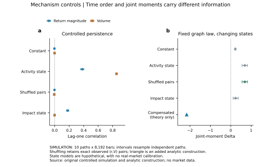
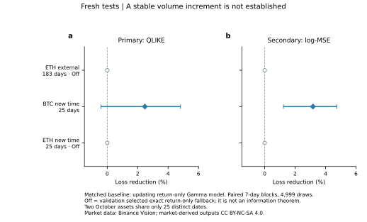
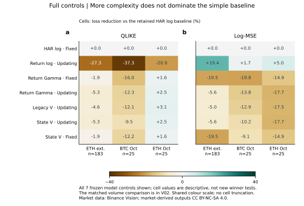
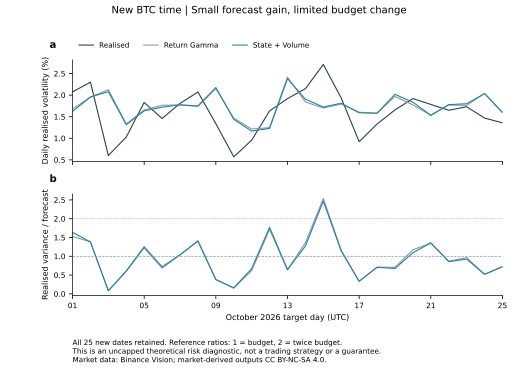

# 状态机制与新留出：量价增益能否变得稳定？

PC5253 · state_forecast_v2 · 2026-10-27 · REAL_DATA / SIMULATION / CONCEPTUAL · 待成员科学复核

## 1. 结论：完成改进检验，仍未获得稳定的大幅量价增益

**本轮增加了持久状态机制、日内活动与成交结构特征、分通道收缩、近期滚动更新，并使用此前未用的ETH与10月数据检验。预先定义的实际增益门槛未达到。** 不能把“实现更复杂模型”写成“得到更有效预测”。

主比较为更新中的状态量价Gamma模型，对照同样更新、相同收益表示的return-only Gamma模型；v2以QLIKE为预设主损失，强制保留原log-MSE。

| 新评价 | 样本 | 主QLIKE改善 | 7日块95%区间 |
|---|---:|---:|---:|
| ETH外部资产，2026年4–9月 | 183日 | 0%：验证选择Off | 算法精确等同基线 |
| BTC新时间，10月1–25日 | 25日 | 2.476% | [-0.407%, 4.815%] |
| ETH新时间，10月1–25日 | 25日 | 0%：验证选择Off | 算法精确等同基线 |

Off是Q1选参决定关闭新增成交通道；零差和退化区间来自完全相同的预测，不是“成交量没有信息”的统计等价证明。BTC主近似原始p=0.086、三项Holm后0.258。

BTC补充log-MSE改善为 **3.170% [1.236%, 4.733%]**，相应三项Holm近似p=0.0276。这是短窗口、补充指标下的正结果；不能替代未通过的主损失与外部资产检查。25日对应7日块仅约3.6个块长度，区间与p依赖很强的近似。

复杂状态模型也没有一致超过保留的简单HAR：QLIKE在ETH外部期约差5.27%，BTC新时间约差9.48%，ETH新时间点改善约2.46%。这些是完整控制表的描述性对照，不能只展示相对新Gamma基线的正改善。

**本轮真正推进了两件事：**明确了时间信息与联合矩的不同作用；通过新留出限制了量价预测优势的承诺。完整的阴性结果、自动退回基线与正的补充结果均保留。

<!-- pagebreak -->

## 2. 机制改进：同一网络分布下的不同记忆

保留ER群体骨架，N=128、rho=1，只改活动概率或价格响应的时间状态：

$$r_t=\frac{\lambda_t}{N}\sum_i s_{i,t}\xi_{i,t},\qquad V_t=u\sum_i s_{i,t}|\xi_{i,t}|.$$

活动概率在0.015与0.45之间持久切换，高状态平稳概率0.15；独立冲击模型改变lambda。四组均量、收益二阶矩在平稳总体上匹配，未人为归一每条实现。10条独立路径，每条8192期，四臂合计327,680个模拟观测。

活动状态产生幅度一期相关约0.381、量相关约0.853；独立冲击状态的幅度相关约0.179，量相关接近零。量的时间结构可帮助区分这些受控机制。

完整置换(r,V)观测对，精确保留经验联合分布与Delta，却使幅度相关接近零。**同期量价统计不能替代时间顺序。** 这不是两个完整时间过程的概率律等价证明。

这些是外生持久状态，不是已实现的内生适应或自组织临界市场。简单状态臂也没有解释此前真实负Delta；图中负三角是另行标出的解释性总体矩构造，详见第7页，不是第五个预测赢家。

<!-- pagebreak -->

## 3. 特征与损失：同时加强仅收益基线

收益输入为8项：日/7日/28日波动、日末4小时波动、负向半方差占比、四阶集中度、最大单根方差占比、标准化日收益。它们进入成交模型和匹配的return-only模型，避免把新增价格信息误归给量。

| 成交状态组 | 保留的信息 | 解释边界 |
|---|---|---|
| 相对量、成交笔数、笔均规模 | 相对各自28日历史，区分活动频率与成交规模 | 笔数不等于交易者数，笔均规模不等于提交订单规模 |
| 日末4小时份额与持续性 | 近期活动位置、I/V和交易笔数的滞后相关 | 是时序代理，不是实测协调网络 |
| 同期量价与响应代理 | 幅度/量秩相关、平方收益协变、无量纲主动量响应 | 非盘口OFI、非真实深度、非因果冲击 |

Gamma准似然以log-link给出正值条件均值候选：

$$\log\mu_{d+1}=b+\beta^Tx_d^R+\gamma^Tx_d^V,$$
$$\min_{b,\beta,\gamma}\sum_d\left[\frac{RV_{d+1}}{\mu_{d+1}}-\log\frac{RV_{d+1}}{\mu_{d+1}}-1\right]+\frac{\alpha_R}2\|\beta\|^2+\frac{\alpha_V}2\|\gamma\|^2.$$

Gamma名称指所用损失与均值模型，不宣称RV条件分布严格服从Gamma。它避免把log预测直接指数变换后当成条件算术均值。原log-MSE仍完整报告，不能靠换目标制造成功。

分通道惩罚允许alpha_V=Off，此时精确退回相应return-only模型；不是用一个大数冒充零通道。标准化与训练RV尺度只用当次训练窗；365日目标窗口，每7日更新，static控制则在评价开始拟合一次。更多输入和更新不保证更低误差。

<!-- pagebreak -->

## 4. 新数据与主检验：外部资产、新时间必须分开

冻结后新增72个官方归档、198,144根行情：ETH 2025年至2026-10-25，共190,944根；BTC新增10月25日共7200根。两个资产各有663个完整历史日，原BTC文件不改。全部新行情无缺失、重复、删除或填补。

每个资产仅用自身2026 Q1选参数。ETH外部资产测试是相同流程用ETH历史重新拟合，不是BTC模型零样本迁移；同期加密市场环境已在BTC研究中出现，不能称独立市场环境。BTC旧Q2/Q3只作开发诊断。

10月BTC/ETH虽共50个资产日，**只有25个不同日期**，共享市场风险，未合并当成独立重复。主对比的三组近似块p作Holm；补充损失另列，其他控制是探索性比较。

研究门槛先定为外部QLIKE改善至少5%、区间高于零、log-MSE不恶化，新时间不矛盾。ETH选择Off，已不能通过此门槛；它不是业界标准，也不能靠短新时间的一个正补充指标替代。

<!-- pagebreak -->

## 5. 全部控制：更复杂不等于更好

每格为相对简单HAR log模型的损失下降，保留全部7个预设方法与3个新评价。正值是改善，负值是退步。主量价归因仍看V02的匹配Gamma比较；本图检查复杂方案是否真正胜过保留的简单方法。

| 新评价 | 简单HAR QLIKE | 更新return-only Gamma | 更新状态量价Gamma |
|---|---:|---:|---:|
| ETH外部183日 | 0.232383 | 0.244631 | 0.244631（Off） |
| BTC新25日 | 0.188590 | 0.211719 | 0.206477 |
| ETH新25日 | 0.209467 | 0.204307 | 0.204307（Off） |

仅收益log模型在ETH外部期的log-MSE相对简单HAR点下降约19.36%，但QLIKE变差约27.27%；Gamma训练降低相对于该log模型的QLIKE，却不保证超过简单HAR。**损失函数对应不同预测目标，不能只选最有利一列。**

近期更新、更多收益特征、更细成交状态都没有一致占优。验证选择关闭成交通道是允许的保守输出，但它只说明本方法在该验证段选择了return-only，不证明成交信息在所有表示、时距和市场都无用。

<!-- pagebreak -->

## 6. 新时间与风险预算：小变化不能包装成决策效益

如理论目标波动暴露取w=sigma_target/sqrt(forecast)，则实现的方差预算比为

$$\frac{w_{d+1}^2RV_{d+1}}{\sigma_{target}^2}=\frac{RV_{d+1}}{\widehat{RV}_{d+1}}.$$

这是一项无上限、无交易实现的诊断，不是资金配置建议或已验证交易策略。比值过低也可能意味着风险暴露不足，不能只赞扬超支变少。

BTC新25日，return-only与状态量价模型的平均预算比分别0.9545、0.9530；超过两倍预算的比例均为4%，即各1日。平均超出一倍预算的部分从0.19584降到0.19236，变化较小。不能据此声称降低了真实投资风险或提高收益。

ETH外部期Gamma方案较某些log模型更保守，但其收益代价、杠杆限制、成本、风险资本与概率覆盖均未测试。图上点预测和预算比不包含经过校准的未来置信区间。

<!-- pagebreak -->

## 7. 更深的机制结论：活动信息可以被价格响应补偿

固定图分布与活动状态独立，A=E S2、m_k=E(q^k)，由全方差公式：

$$\operatorname{Var}(V)=u^2[(m_1-m_2)A+N^2(m_2-m_1^2)].$$

第二项来自活动状态的变化。把全部量方差解释成群体结构，会混淆活动和拓扑。网络rho保持1时，理论Delta由固定活动的0.2121变为活动混合的0.7881；这不等于网络更接近临界。

作为主分析后的解释性构造，沿用同一两状态q，令

$$\lambda(q)^2=\lambda_0^2\frac{\bar q}{q}.$$

这使E[r²|q]保持相同，也保持总体均量和收益方差；同一q/图/动作下量过程不变。但

$$\frac{\operatorname{Cov}(r^2,V)}{\operatorname{Var}(r)}=u(1-\bar q)\frac{\mathbb ES_3}{\mathbb ES_2},$$

与活动混合的成交量三阶矩结合，给出Delta约 **-2.1635**。小图已用精确分数枚举核验；有限N用高精度随机图矩计算。它不是拟合真实Delta=-8.18，也未新增一个预测方法。

更进一步，在该构造及未来图、动作噪声独立于过去的前提下，迭代期望给出

$$\mathbb E[r_{t+1}^2\mid\mathcal F_t]=(\lambda_0/N)^2\bar q A.$$

右侧为常数。成交量即使揭示活动状态，也不增加这个特定条件二阶矩目标的信息；不是市场一般不可预测定理。

因此，固定接口受真实负Delta挑战，不等于所有羊群机制被否证；同时，成交活动含有机制诊断信息，也不保证能带来稳定的下一日方差预测增量。这里得到的是明确的机制边界，不是对真实交易者状态的恢复。完整推导见[机制增补](../../../docs/theory/STATE_MECHANISM_v2.md)。

<!-- pagebreak -->

## 8. 交付、验收与研究判断

新增118项独立检查通过：重读全部新198,144根归档、核对收益与时间网格；检查未来扰动、每次重训日期；用独立SciPy优化器复算Gamma预测；检验单位不变性、Off恒等与损失；小图精确核验补偿构造。受控模拟包含10路径与完整对置换核验。

独立目录可从官方重建全部数据，复跑全部预测与机制，比较12张预测表、4张机制表和解压后的机制原始序列。完整真实行情不入交接包，保留下载器与SHA256；市场衍生成果署名Binance Vision、CC BY-NC-SA 4.0。自动通过不代替成员科学签收。

| 可支持的判断 | 不能升级的判断 |
|---|---|
| BTC新时间有小的主损失点改善、补充log指标正结果 | 已获得跨资产、稳定大幅的量价优势 |
| ETH验证选择关闭额外通道 | 已证明量价没有任何预测信息 |
| 动态状态与响应补偿改变联合约束 | 已识别真实市场的活动/流动性机制 |
| 一些预测损失或预算诊断改善 | 实盘收益、成本后效益或风险资本已验证 |

当前应保留简单HAR和return-only参照，不将复杂量价方案默认升级为实用赢家。课程展示可突出机制可检验性、严格新数据边界、完整控制和阴性结果；不再在当前留出上反复调参追逐显著性。若继续，应先明确更短时间尺度或盘口信息的新机制问题，重新冻结并准备未用检验。

方法与材料：[统计附录](stats-appendix.md)、[图表目录](figure-catalog.md)、[主张账本](claim-candidates.md)、AB/CD交接（原内部交接记录）、[配置](../../../configs/state_forecast_v2.json)。

理论定位：[Cont–Bouchaud](https://arxiv.org/abs/cond-mat/9712318)提供群体协调骨架；[Bouchaud等](https://arxiv.org/abs/cond-mat/0307332)研究时变交易响应；[Cont–Kukanov–Stoikov](https://arxiv.org/abs/1011.6402)研究完整盘口OFI，本项目的成交方向代理不同。[Patton](https://scholars.duke.edu/publication/792433)提供波动代理与损失比较动机。本轮具体状态模型与补偿构造不主张文献新颖性已确立。
