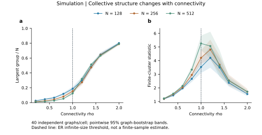
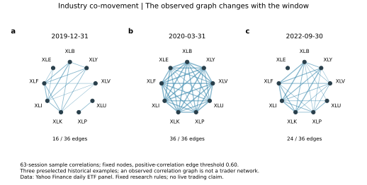
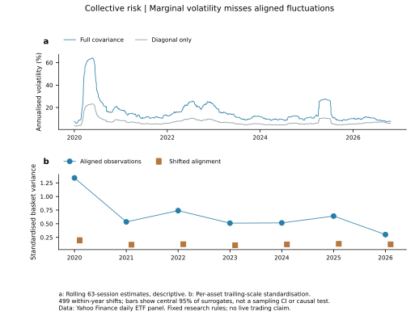
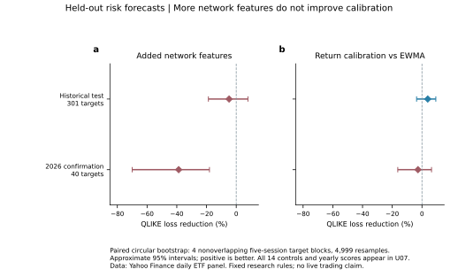
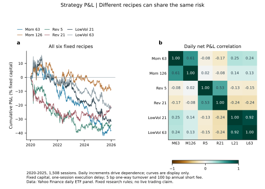
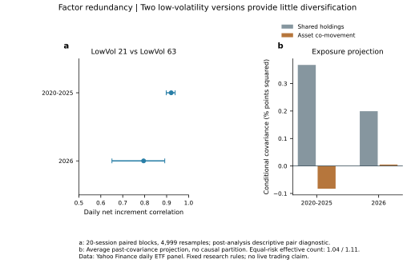
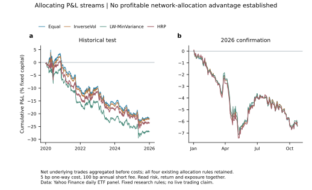
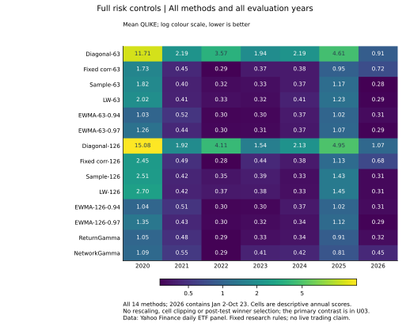

# 群体波动、行业联动与策略P&L

PC5253 · 2026-10-27 · AB · 美股应用分析，待成员科学复核

## 1. 结论：量化了遗漏与冗余，未得到新预测或盈利优势

本批完成十一ETF日线、九行业相关网络、组合风险分解、六条固定策略P&L和四种既有配置方法。新增网络特征的风险预测不优于匹配收益模型；HRP也未建立稳定配置优势。保留全部控制和成本敏感性，不继续用当前留出调参。

**支持的实际用途是风险模型审计和因子冗余筛查。** 历史期逐日63日估计中，行业联动方差占比均值为78.14%，完整/对角波动之比的中位数为2.11。两个低波动参数版本的每日净P&L相关为0.921，等风险两策略的有效数量约1.04。这些不是新alpha或可实现收益。

| 评价区间 | 五日目标数 | QLIKE改善 | 近似95%区间 |
|---|---:|---:|---:|
| 2020–2025 | 301 | -4.80% | [-18.73%, 7.89%] |
| 2026确认 | 40 | -38.73% | [-70.01%, -18.02%] |

负改善表示误差增加；2026只含40个非重叠目标，长期稳定性不能由此保证。历史主区间跨零；确认区间完全为负。预设研究门槛未达。

新数据共46,530行、4,230个收盘日期（含2009年末两日参考），研究日期2010年至2026-10-23共4,228日。原始字段逐条重建核对；全部交易日对齐，无填补或删除。时间留出不是对已知历史事件的盲测。

<!-- pagebreak -->

## 2. 保留物理主线：群体放大到观测投影

上图为既有模拟证据，并非本批美股估计。课程主体仍是羊群交互、群体连通、渗流/临界、收益尾部和时间标度；泡沫/崩盘与适应机制由原始文献综述说明，不把静态基线称为已实现的适应市场。

原模型群体二阶矩控制波动：

$$r=\frac{\lambda}{N}\sum_Cs_C\xi_C,\qquad \operatorname{Var}(r)=q(\lambda/N)^2 E S_2,\quad S_2=\sum_Cs_C^2.$$

作为明确条件下的观测扩展，设多维观测$Z=\sum_Cb_C\xi_C+\epsilon$，策略权重$W$在动作前已确定，则

$$\operatorname{Cov}(WZ)=q\sum_C(Wb_C)(Wb_C)^T+WDW^T.$$

共同载荷会通过策略暴露投影成共同P&L风险。该补充推导在主结果后提出，81状态有理数枚举通过；未用作预测方法或市场拟合。详见[完整条件与证明](../../../docs/theory/COLLECTIVE_PNL_v1.md)。真实相关矩阵没有微观群体标签，不能识别真实羊群/临界点。

<!-- pagebreak -->

## 3. 数据与行业联动：观察结构，不制造真实网络

九行业为XLB/XLE/XLF/XLI/XLK/XLP/XLU/XLV/XLY，SPY/QQQ只作参照；ETF持仓与行业定义随历史改变，不代表完整美股。供应商复权收盘构造总回报代理，原始OHLCV、分红和拆股同时保存；当前复权历史不是历史时点数据版本。

2010–2017训练，2018–2019选参，2020–2025历史留出。验证选择及代码哈希锁定后才获取2026年1月2日至10月23日的204日确认数据。确认期与既有加密研究共享部分市场背景，不是所有意义上的独立复现。

U01采用相同节点位置和0.60正相关阈值，相关窗口为63个交易日；三个历史日期事先指定。它展示收益关联，不是交易者、持股或因果传播网络。九节点图不能证明热力学临界性。

美股日线与加密5分钟数据不直接横比尾指数、原始成交量或不同目标的损失。本批未把成交量加入预测：检验的是横截面联动信息，不能称量价增益。

<!-- pagebreak -->

## 4. 联动风险与对齐信息：有数值，解释有边界

$$\hat v_p=w^T\hat\Sigma w=\sum_iw_i^2\hat\sigma_i^2+2\sum_{i<j}w_iw_j\hat\sigma_{ij},\qquad w_i=1/9.$$

2020–2025逐日滚动估计中，联动项占比均值78.14%；2026为52.93%。完整/对角波动比中位数分别2.11、1.66。这是一项同窗估计分解，不是真实条件方差或样本外预测增益。

每资产先按此前63日标准差标准化，再在每年内各自循环移位。每年的各资产经验边际值不变，而跨资产日期对齐改变。图中移位范围来自499次条件移位，不是抽样CI或因果p值；非平稳性/循环接缝限制其解释。完整逐年统计和全部重复均保留。

<!-- pagebreak -->

## 5. 未来风险：强参照有效，新增网络校准未通过

$$Y_{t,5}=\frac15\sum_{h=1}^5(w^TR_{t+h})^2,\qquad L(Y,v)=Y/v-\log(Y/v)-1.$$

Y是未来五日平均平方收益，不是日内RV或可观察的真实条件方差。五类控制、两种窗口、EWMA两个衰减及两种Gamma校准全部保留。验证选择的强参照为EWMA-126-0.94；Gamma用$v_0$作offset，收益形状三项进入两模型，相关谱三项仅进入网络模型。

| 评价 | 对角63 | 强EWMA | 收益Gamma | 网络Gamma |
|---|---:|---:|---:|---:|
| 2020–2025 | 4.3888 | 0.5904 | 0.5674 | 0.5947 |
| 2026确认 | 0.9125 | 0.3131 | 0.3215 | 0.4460 |

常规EWMA相对对角控制的QLIKE分别下降86.55%、65.69%。它说明不能忽略联动及时间更新，**不是我们的新方法超过常规风险模型**；两种方法还同时具有估计/更新差别，不能把全部改善归因于相关性。

<!-- pagebreak -->

## 6. P&L：每日增量才是主要依赖对象

固定规则为动量63/126日（跳过21日）、反转5/21日、低波动21/63日。每次在九ETF中多3空3，目标gross=1。每周最后交易日收盘执行，用前一日及以前信号；持仓从下一交易日赚取盈亏，周内固定总回报指数单位。

$$p_{s,t}=\sum_iq_{s,i,t-1}(T_{i,t}-T_{i,t-1})-c\sum_i|\Delta q_{s,i,t}|T_{i,t}-b_t.$$

主成本为每单边成交额5bp、空头100bp假设年借券费；另保留0/10/25bp。不是实际成交/券源数据。盈亏按固定参考资本相加，不报CAGR或可实现收益。

低波动两版本在2026的每日净P&L相关0.795，累计曲线相关约0.985。累计曲线会改变依赖度量；不能用它代替每日增量来判断独立性。

<!-- pagebreak -->

## 7. 因子挖掘的正向作用：识别冗余及暴露来源

训练期最高正相关规则选出LowVol-21/63。这个解释性诊断是在主结果之后追加，不能冒称新的预注册检验。历史每日相关0.921，20日块区间[0.898,0.939]；确认相关0.795，区间[0.651,0.891]。

若两条策略作等风险配置，其有效独立风险来源数$2/(1+\rho)$约为1.04、1.11；它不是独立alpha数量。参数数量增加不能直接算作分散化增加。

$$\hat\Sigma^{PL}=W\hat\Sigma W^T=W\operatorname{diag}(\hat\Sigma)W^T+W[\hat\Sigma-\operatorname{diag}(\hat\Sigma)]W^T.$$

共享持仓和资产协方差项可正可负。该低波动例子的历史交叉资产项抵消部分共享暴露项；不能把所有市场共同波动都描述成增加长短策略风险。这是当前暴露下的风险候选，不是未来P&L精确分解或唯一因果来源。用途是候选筛查/暴露审计，低相关或高相关均不能单独证明alpha。

<!-- pagebreak -->

## 8. 配置实际例子：全部成本后曲线为负

Equal、InverseVol、LW-MinVariance及HRP使用过去126日净增量，调仓保留一交易日信号延迟；组合先聚合底层持仓再扣成本，避免重复计费。验证选择强配置参照为LW-MinVariance。

| 评价 | 方法 | 累计净P&L | 年化波动 | 平均底层gross |
|---|---|---:|---:|---:|
| 历史 | Equal | -21.68% | 4.35% | 0.487 |
| 历史 | InverseVol | -22.04% | 4.39% | 0.491 |
| 历史 | LW-MinVariance | -26.86% | 4.25% | 0.506 |
| 历史 | HRP | -23.43% | 4.42% | 0.505 |
| 确认 | Equal | -6.44% | 3.84% | 0.491 |
| 确认 | InverseVol | -6.40% | 3.84% | 0.496 |
| 确认 | LW-MinVariance | -6.09% | 3.97% | 0.502 |
| 确认 | HRP | -6.33% | 3.91% | 0.511 |

HRP相对强参照的波动下降为历史-4.06%（区间[-8.59%,1.05%]）、确认1.53%（[-1.22%,4.05%]）。均未建立稳定优势；全部曲线亏损，不称有效因子发现。结果仅限这些九ETF样例，不否定全部学术动量/防御因子。

<!-- pagebreak -->

## 9. 全部风险控制与年份

矩阵保留14种方法；颜色为正QLIKE的对数尺度，数值没有截断。逐年点估计只作稳定性描述，不能事后挑最佳年份或追加赢家检验。

主不确定性为配对的4个五日目标块，4999次循环bootstrap，另1/13块敏感性。历史301个目标、确认40个目标；后者主块只有约10个块长度，依赖/非平稳使区间近似。主两项Holm已保留；原始重采样尾比例为0时代表分辨率下限，不是概率为0。

网络指标由同一相关矩阵计算，没有增加原始信息。此结果限制本次特征/估计器的预测主张，不能推出所有结构信息或所有学习器无用。

<!-- pagebreak -->

## 10. 复现、方法与汇报的主张范围

先读[冻结契约](../../../docs/AB/us_equity_v1_contract.md)、[统计附录](stats-appendix.md)、[图源/图注](figure-catalog.md)与AB交接（原内部交接记录）。运行入口和完整表随交接包提供，真实行情通过来源记录重建；公开访问不自动等于再分发授权。

复现区分两种口径：固定首次数据快照在独立目录重建19张CSV和15个持仓数组，全部精确一致；重新下载时仅复权收盘字段出现最大约1.10e-6的相对差异，主增量点估计改变不足0.0011个百分点，方向未变。完整原始收盘/成交量/分红拆股未变，供应商计算差异来源不确定；保留两份来源并明确外部下载不能逐字节复现。

方法包括：交易日历/公司行动检查、滚动协方差与相关谱、保边际的移位对照、Gamma准似然条件均值、训练/验证/历史/确认四段、块bootstrap、固定规则P&L与费用、既有HRP/收缩配置、已知暴露的矩阵投影。未使用真实潜在网络标签、盘口订单流、因子大搜索或量子优势结论。

原始研究连接：

- [Mantegna：金融收益的层级结构](https://arxiv.org/pdf/cond-mat/9802256)：收益相关网络的研究基础，不是微观网络恢复证明。
- [Ledoit–Wolf：协方差收缩](https://econ-papers.upf.edu/papers/691.pdf)：强风险参照的动机；本代码用sklearn scaled-identity目标，与该文constant-correlation目标有别。
- [López de Prado：HRP作者算法入口](https://www.quantresearch.org/Software.htm)：层次配置的既有参照，独立实现，未宣称原创或稳定超额收益。
- [Moskowitz–Grinblatt：行业动量](https://www.aqr.com/insights/research/journal-article/do-industries-explain-momentum)：经济背景，本六条ETF规则不是该论文的严格复制。
- [Bailey等：回测过拟合](https://www.davidhbailey.com/dhbpapers/backtest-prob.pdf)、[Harvey等：因子多重检验](https://people.duke.edu/~charvey/Research/Published_Papers/P118_and_the_cross.PDF)：固定候选、保留试验范围与不事后筛赢家的依据；没有声称已执行其PBO或发现新alpha。

本批可用于汇报的贡献：保留课程物理机制，量化哪些风险会被简化假设遗漏，展示如何筛查冗余因子，并用新确认期检验应用边界。成员科学签收、最终PPT、交互诊断器和公开GitHub仍待完成。
